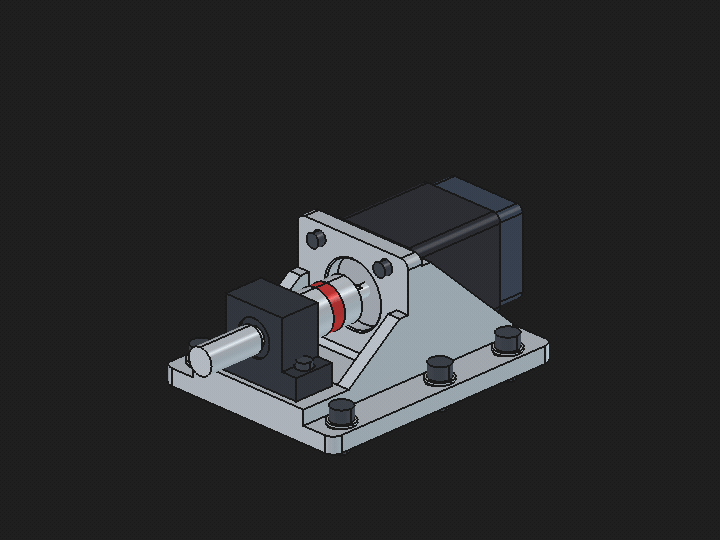

# FreeCAD MCP Workbench

[](https://wiki.freecad.org/Workbench_creation)
[](https://modelcontextprotocol.io/)
[](LICENSE)

> **Build, inspect, animate, stress-test (FEA), and export parametric 3D CAD models directly inside a live FreeCAD window from Codex, Claude Code, Claude Desktop, Antigravity, or Cursor.**

<p align="center">
  
</p>

<p align="center">
  <em><strong>Example built completely by prompt:</strong> Integrated NEMA 23 Servo + BK12 Ballscrew CNC Router Mount (6061-T6 Al) with exploded assembly, CalculiX FEA (SF = 21.7×), BOM, Cut Sheet &amp; 11×17" fillable machinist drawing — see <a href="examples/nema23-bk12-cnc-bracket/"><code>examples/nema23-bk12-cnc-bracket/</code></a>.</em>
</p>

<a href="https://buy.stripe.com/8x2cN64n6dUGcLabg0bsc00">Buy me a coffee.</a>
---

## What's Included in This Repository

This repository is structured as a **standard FreeCAD Addon Manager Workbench** (per [FreeCAD Workbench Creation](https://wiki.freecad.org/Workbench_creation) & [Package Metadata](https://wiki.freecad.org/Package_Metadata)) **and** bundles the matching deployable Python MCP server so you can deploy the entire stack on any machine (Linux, macOS, Windows):

| Component | Path | Purpose |
| :--- | :--- | :--- |
| **FreeCAD Workbench Addon** | `Init.py`, `InitGui.py`, `package.xml`, `rpc_server/` | Installs straight into FreeCAD's `Mod/` directory (or Addon Manager) and runs the in-FreeCAD XML-RPC bridge (`127.0.0.1:9875`). |
| **Workbench & Toolbar Icons** | `Resources/icons/FreeCADMCPWorkbench.svg` + 7 command SVGs | 64×64 vector SVG icons for the FreeCAD workbench selector, Addon Manager, and toolbar actions (including an in-FreeCAD **AI Client Setup** dialog). |
| **Bundled MCP Server Package** | `pyproject.toml`, `src/freecad_mcp/` | Standalone Python MCP server (`freecad-mcp` v0.1.32, protocol v3) runnable via `uvx` or installed offline directly from this repo. |
| **Shared AI Agent Skill** | `skills/freecad-mcp/SKILL.md` | Teaches Codex, Claude, and Antigravity the full iterative CAD workflow (parametric Python, visual `get_view` checks, `doc.CreatedBy` stamping, headless OCCT ops, and FEA). |
| **1-Command Client Installer** | `scripts/setup_mcp_clients.py` | Automatically writes MCP configs and installs `SKILL.md` for Codex, Claude Code, Claude Desktop, Antigravity, and Cursor. |
| **Real-World Showcase Example** | `examples/nema23-bk12-cnc-bracket/` | Complete NEMA 23 + BK12 CNC bracket with `.FCStd`, `.step`, `.stl`, 11×17" fillable PDF drawing, BOM, cut sheet, CalculiX FEA, exploded GIF, and exact prompt log. |

---

## Step 1: Install the Workbench in FreeCAD

### Option A — Directly Inside FreeCAD's Addon Manager (Recommended)
1. Open FreeCAD → **Edit → Preferences → Addon Manager**.
2. Under **Custom Repositories**, click **+** and add:
   - **URL:** `https://github.com/Rocketmanwookie/FreeCAD-MCP-Workbench`
   - **Branch:** `main`
3. Open **Tools → Addon Manager**, search for **FreeCAD MCP Workbench**, and click **Install**.
4. Restart FreeCAD.

*(Once added to the official FreeCAD 1.0+ Addon Index [`FreeCAD/Addons`](https://github.com/FreeCAD/Addons), users can skip steps 1–2 and install directly from the built-in Addon Manager list. See [docs/ADDON_MANAGER_SUBMISSION.md](docs/ADDON_MANAGER_SUBMISSION.md).)*

### Option B — Manual Clone to FreeCAD's `Mod/` Folder
Clone directly into your FreeCAD user `Mod/` directory:

- **Linux:**
  ```bash
  git clone https://github.com/Rocketmanwookie/FreeCAD-MCP-Workbench.git ~/.local/share/FreeCAD/Mod/FreeCADMCP
  ```
- **macOS:**
  ```bash
  git clone https://github.com/Rocketmanwookie/FreeCAD-MCP-Workbench.git "$HOME/Library/Application Support/FreeCAD/Mod/FreeCADMCP"
  ```
- **Windows (PowerShell):**
  ```powershell
  git clone https://github.com/Rocketmanwookie/FreeCAD-MCP-Workbench.git "$env:APPDATA\FreeCAD\Mod\FreeCADMCP"
  ```

### Activate the RPC Bridge in FreeCAD
1. Restart FreeCAD and pick **FreeCAD MCP** from the Workbench dropdown.
2. Click **Start RPC Server** (green play icon) to start listening on `127.0.0.1:9875`.
3. *(Recommended)* Toggle **Auto-Start Server** (lightning icon) so the RPC server starts automatically whenever you open FreeCAD.
4. Click **AI Client Setup** (terminal icon) anytime inside FreeCAD to view & copy client configs.

---

## Step 2: Connect Your AI Client(s)

You need Python 3.12+ and [`uv` / `uvx`](https://docs.astral.sh/uv/getting-started/installation/).

### Fast Path — One-Command Setup Script
Configure all installed AI clients and install the `freecad-mcp` agent skill in one command:

```bash
# Preview changes first
python3 scripts/setup_mcp_clients.py --all --dry-run

# Configure Codex, Claude Code, Claude Desktop, Antigravity & Cursor
python3 scripts/setup_mcp_clients.py --all

# Or deploy offline/pinned directly from this local repo clone:
python3 scripts/setup_mcp_clients.py --all --from-local-repo
```

Or configure each client manually below:

---

### OpenAI Codex (CLI & Desktop)

> **Important:** Do **not** point Codex at `url = "127.0.0.1:9875"` — port `9875` is FreeCAD's XML-RPC bridge, not an HTTP MCP endpoint. Codex must run the `freecad-mcp` stdio server via `uvx`.

```bash
codex mcp add freecad -- uvx freecad-mcp
```

Or add to `~/.codex/config.toml`:
```toml
[mcp_servers.freecad]
command = "uvx"
args = ["freecad-mcp"]
```

**Install the Codex Skill** (so Codex knows how to discover the deferred `mcp__freecad` tools and design iteratively):
```bash
mkdir -p ~/.codex/skills
ln -s /path/to/FreeCAD-MCP-Workbench/skills/freecad-mcp ~/.codex/skills/freecad-mcp
```

---

### Antigravity (`agy` CLI & IDE)

Add to your global config at `~/.gemini/config/mcp_config.json`:
```json
{
  "mcpServers": {
    "freeCAD": {
      "command": "uvx",
      "args": ["freecad-mcp"]
    }
  }
}
```

**Install the Antigravity Skill:**
```bash
mkdir -p ~/.gemini/config/skills
ln -s /path/to/FreeCAD-MCP-Workbench/skills/freecad-mcp ~/.gemini/config/skills/freecad-mcp
```

---

### Claude Code (CLI)

```bash
claude mcp add --scope user freecad -- uvx freecad-mcp
```

Or add to `~/.claude.json` under `"mcpServers"`:
```json
{
  "mcpServers": {
    "freecad": {
      "command": "uvx",
      "args": ["freecad-mcp"]
    }
  }
}
```

**Install the Claude Code Skill:**
```bash
mkdir -p ~/.claude/skills
ln -s /path/to/FreeCAD-MCP-Workbench/skills/freecad-mcp ~/.claude/skills/freecad-mcp
```

---

### Claude Desktop & Cursor

- **Claude Desktop:**
  - macOS: `~/Library/Application Support/Claude/claude_desktop_config.json`
  - Windows: `%APPDATA%\Claude\claude_desktop_config.json`
  - Linux: `~/.config/Claude/claude_desktop_config.json`
- **Cursor:** `~/.cursor/mcp.json`

```json
{
  "mcpServers": {
    "freecad": {
      "command": "uvx",
      "args": ["freecad-mcp"]
    }
  }
}
```

> **Offline / Local Repo Deployment:** To run the exact MCP server bundled in this repo without PyPI, replace `"args": ["freecad-mcp"]` with `"args": ["--from", "/path/to/FreeCAD-MCP-Workbench", "freecad-mcp"]` (or install globally via `uv tool install /path/to/FreeCAD-MCP-Workbench`).  
> **Save Tokens:** Append `"--only-text-feedback"` to `args` to disable automatic viewport screenshots on every tool call.

---

## Included Showcase Example: NEMA 23 + BK12 CNC Router Table Mount

Everything in [`examples/nema23-bk12-cnc-bracket/`](examples/nema23-bk12-cnc-bracket/) was created interactively in FreeCAD using this workbench and natural-language prompts:

- **Monolithic 6061-T6 Bracket:** `120 × 156 × 76 mm` (`790 g`) uniting a standard NEMA 23 servo faceplate (`Ø38.5 mm` pilot bore, `47.14 mm` M5 pattern, shaft centerline `Z = 44.0 mm`) with a machined BK12 fixed ballscrew pedestal (`Z = 19.0 mm` + `25.0 mm` BK12 shaft height = exact `44.0 mm` coaxial alignment), twin 8 mm continuous stiffening webs, 45 mm open coupler bay, and 6 outer M6/M8 CNC table T-slot wings.
- **CalculiX 2.23 FEA Stress Check (`3,500 N` stall thrust):** Peak von Mises **`12.74 MPa`** (**SF = 21.66×** against 276 MPa 6061-T6 yield), max deflection **`4.2 µm`** (`0.0042 mm`).
- **Complete Manufacturing Package:**
  - Native FreeCAD project with exploded & assembled views + `CreatedBy`: [`nema23-bk12-cnc-bracket.FCStd`](examples/nema23-bk12-cnc-bracket/nema23-bk12-cnc-bracket.FCStd)
  - CNC / 3D print exports: [`.step`](examples/nema23-bk12-cnc-bracket/nema23-bk12-cnc-bracket.step) | [`.stl`](examples/nema23-bk12-cnc-bracket/nema23-bk12-cnc-bracket.stl)
  - 11×17" ANSI B machinist drawing with 27 fillable PDF title-block fields: [`nema23-bk12-cnc-bracket-drawing-11x17.pdf`](examples/nema23-bk12-cnc-bracket/nema23-bk12-cnc-bracket-drawing-11x17.pdf)
  - Shop documentation: [`BOM.md`](examples/nema23-bk12-cnc-bracket/BOM.md) | [`BOM.csv`](examples/nema23-bk12-cnc-bracket/BOM.csv) | [`CUTSHEET.md`](examples/nema23-bk12-cnc-bracket/CUTSHEET.md)
  - Exact prompts used: [`PROMPTS_AND_MANIFEST.md`](examples/nema23-bk12-cnc-bracket/PROMPTS_AND_MANIFEST.md)

---

## Troubleshooting

### Linux (Arch / Hyprland / Wayland) — FreeCAD 1.1.x Freezing on Startup
FreeCAD 1.1 with Qt6 can hit a re-entrant mutex self-deadlock on startup when Qt's AT-SPI accessibility bridge logs `(qt.accessibility.atspi) Received text event for invalid interface.` inside `Gui::NotificationArea::showInNotificationArea()`.

Launch FreeCAD with that Qt warning category suppressed:
```bash
QT_LOGGING_RULES=qt.accessibility.atspi.warning=false FreeCAD
```
To make it permanent for your desktop launcher, copy `/usr/share/applications/org.freecad.FreeCAD.desktop` to `~/.local/share/applications/org.freecad.FreeCAD.desktop` and prefix `Exec=` with `env QT_LOGGING_RULES=qt.accessibility.atspi.warning=false `.

---

## Workbench Directory Structure (Per FreeCAD Wiki)

```text
FreeCAD-MCP-Workbench/
├── Init.py                       # Console + GUI startup hook
├── InitGui.py                    # Registers FreeCADMCPWorkbench + auto-start
├── package.xml                   # FreeCAD Addon Manager manifest (format="1")
├── pyproject.toml                # Deployable Python MCP server package
├── LICENSE                       # MIT License
├── README.md                     # Documentation
├── Resources/
│   └── icons/
│       ├── FreeCADMCPWorkbench.svg   # 64x64 Workbench & Addon Manager icon
│       ├── StartRPCServer.svg
│       ├── StopRPCServer.svg
│       ├── AutoStartRPC.svg
│       ├── RemoteAccess.svg
│       ├── AllowedIPs.svg
│       ├── AuthToken.svg
│       └── ClientSetup.svg
├── rpc_server/                   # FreeCAD XML-RPC server & GUI commands
├── src/freecad_mcp/              # Bundled MCP stdio/HTTP server (v0.1.32)
├── skills/freecad-mcp/SKILL.md   # Shared AI agent workflow skill
├── scripts/setup_mcp_clients.py  # Cross-platform client installer
├── docs/ADDON_MANAGER_SUBMISSION.md
└── examples/nema23-bk12-cnc-bracket/
```

---

## License & Credits

Licensed under the [MIT License](LICENSE).  
Built upon the MIT-licensed [`neka-nat/freecad-mcp`](https://github.com/neka-nat/freecad-mcp) RPC bridge & MCP server (v0.1.32), packaged as a standalone FreeCAD Addon Manager workbench with custom SVG icons, an in-FreeCAD AI Client Setup dialog, cross-client installer, reusable agent skill, and the NEMA 23 + BK12 showcase example.
